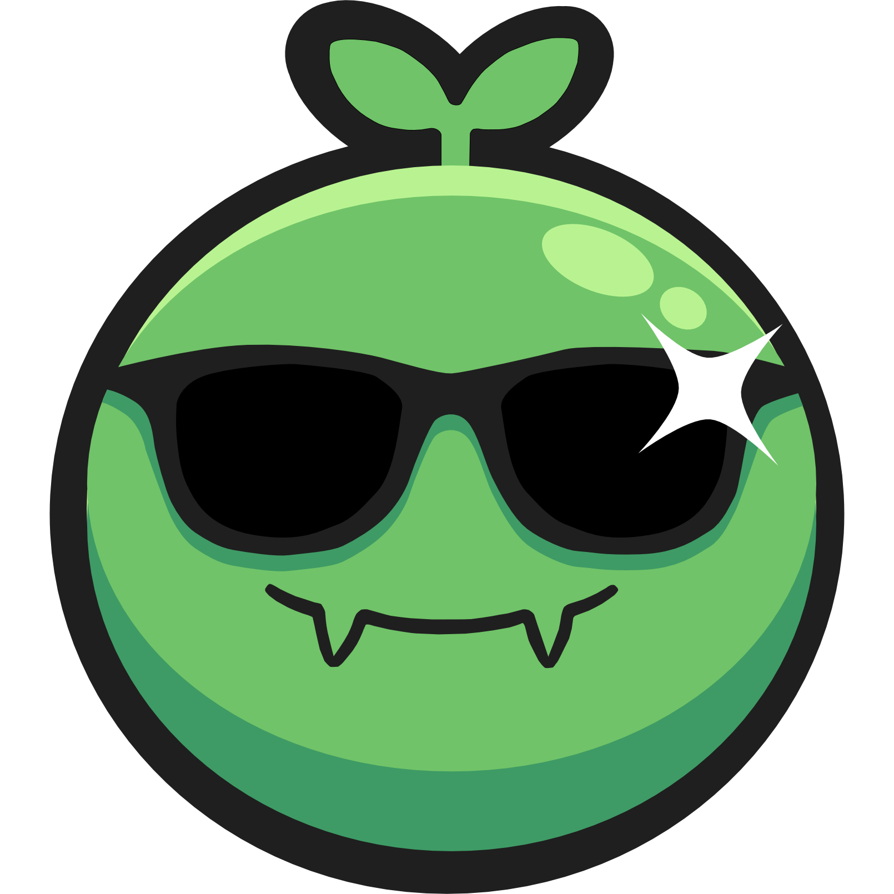

<p align="center">
  
</p>

<h1 align="center">Overkot</h1>

<p align="center">Timers, maps and player progress in a desktop overlay for Soulframe.</p>

<p align="center">
  <a href="https://overkot.com/features">Explore the widgets</a> ·
  <a href="https://overkot.com/guide">Read the player guide</a> ·
  <a href="https://overkot.com/download">Download Overkot</a>
</p>

## Run from source

You'll need **Git** and **Node.js 22.12 or newer in the 22.x series**, with npm. Overkot supports Windows 10 and 11. Linux support for Soulframe under Wine or Proton is experimental.

```sh
git clone --recurse-submodules https://github.com/CameronGuthrie/overkot.git
cd overkot
npm ci
npm start
```

Already cloned the repo? Run `git submodule update --init --recursive` to fetch the translations pinned to your checkout.

**In game**, press <kbd>Shift</kbd> + <kbd>F1</kbd> to interact with the overlay and open the widget picker. Press the shortcut again to return control to Soulframe.

## Build a package

Run a build on its target operating system. Each command writes the package and a `.sha256` checksum to `dist/`. Build one format at a time because the commands share a staging directory.

| Platform | Package | Command |
| --- | --- | --- |
| Windows x64 | Installer | `npm run build:win` |
| Windows x64 | Portable executable | `npm run build:portable` |
| Linux x64 | Debian or Mint package | `npm run build:deb` |
| Linux x64 | Arch package | `npm run build:arch` |
| Linux x64 | AppImage | `npm run build:linux:portable` |

**Windows** builds use the 64-bit .NET Framework 4.x C# compiler (`csc.exe`) for the native helpers. **Linux** builds use the .NET 8 SDK and a native toolchain. Start with the package list and build environment for your platform. [Debian and Mint](docs/linux-mint.md) · [Arch](docs/linux-arch.md)

## Configure a fork

A fresh source build runs without an Overkot account or service key. You can open the game log viewer right away. Automatic updates, telemetry and the official online services are off by default. Widgets that use a data feed can reuse verified downloads offline.

You can export images and icons from Soulframe with [Soulkit](https://github.com/CameronGuthrie/soulkit).

<details>
<summary><strong>Connect your own CDN and game-data feed</strong></summary>

Create `services.community.json` in the repository root. Set `imageBase` to the directory above `SF/Interface/Graphics/` and `dataManifest` to an Overkot-compatible manifest. You can use either setting on its own.

```json
{
  "imageBase": "https://assets.example.org/images",
  "dataManifest": "https://cdn.example.org/overlay/v2/manifest.json"
}
```

Select the file in your shell before running `npm start` or a packaging command. A packaged build remembers the settings you build it with.

**PowerShell**

```powershell
$env:OVERKOT_SERVICES_FILE = (Resolve-Path .\services.community.json).Path
```

**Bash or Zsh**

```sh
export OVERKOT_SERVICES_FILE="$PWD/services.community.json"
```

Use HTTPS for hosted services or loopback HTTP for local development. The profile also accepts `marketWebsite` for the Market launcher, `wikiWebsite` for a MediaWiki instance and `buildWebsite` for a site that handles Overkot build imports. [Service settings](src/modules/serviceConfig.js) · [Manifest format](src/modules/dataUpdates.js)

</details>

For an official build, set `OVERKOT_SERVICES_FILE=config/official-services.json` in `.env.local` or your shell. Source runs and packaging use the same profile. Official release CI also selects the pinned private Market frontend. The full local Market checkout is enabled with `OVERKOT_MARKET_UI=enabled`.

## Contribute

| While working on the app | Command |
| --- | --- |
| Start with debug logging | `npm run dev` |
| Run the test suite | `npm test` |
| Check translations and interface strings | `npm run i18n:check` |

**Translations** live in the `langs/` submodule. Submit new languages and wording fixes to the localisation repository. After a translation lands, update the submodule in the app and run `npm run i18n:check`. [Overkot localisations](https://github.com/CameronGuthrie/overkot-localisations)

## License

© 2026 Overkot contributors. Overkot's source code is licensed under the [GNU Affero General Public License v3.0](LICENSE) (`AGPL-3.0-only`).
